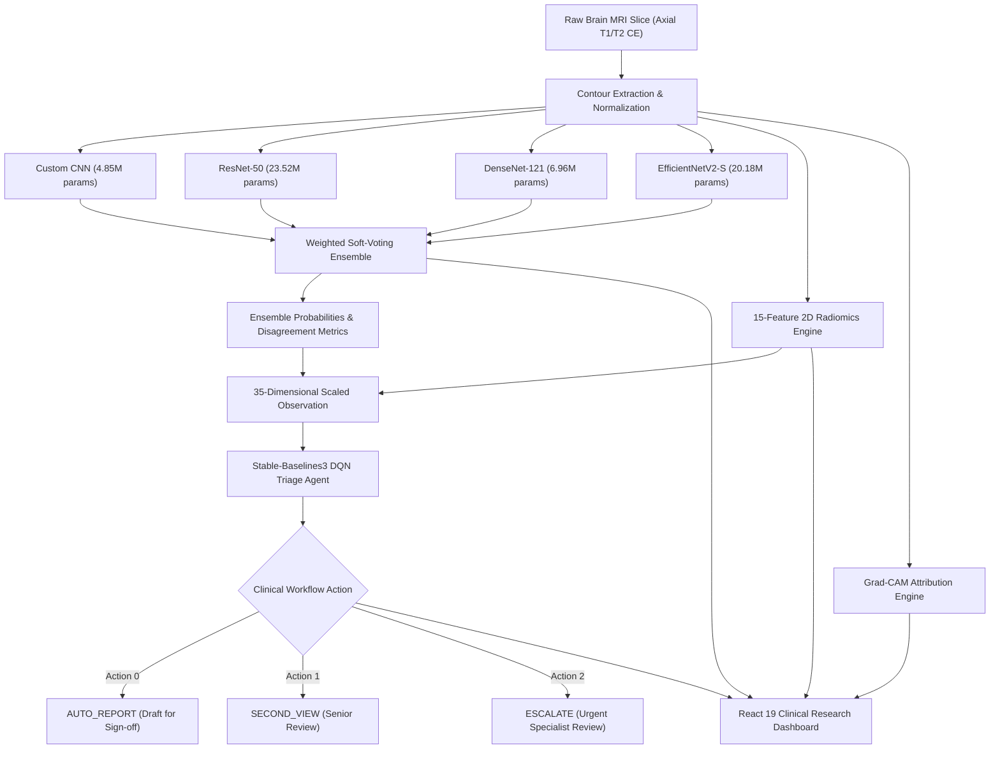

# NeuroScan AI: Explainable Brain MRI Classification & RL Clinical Triage

[](https://www.python.org/)
[-EE4C2C.svg)](https://pytorch.org/)
[](https://fastapi.tiangolo.com/)
[](https://react.dev/)
[](https://docs.pytest.org/)

NeuroScan AI is a research decision-support platform designed to evaluate deep learning explainability and reinforcement learning-driven clinical review triage for brain tumor magnetic resonance imaging (MRI).

> [!IMPORTANT]
> **CRITICAL CLINICAL & REGULATORY DISCLAIMER**:
> NeuroScan AI is an investigational research prototype for clinical decision-support and workflow simulation. It is **NOT** a certified Medical Device (SaMD) and is **NOT** cleared for autonomous clinical diagnosis, surgical boundary resection planning, or patient discharge without licensed radiologist validation.

---

## 1. System Architecture

The end-to-end diagnostic and review pipeline operates across 5 decoupled layers:



### Architectural Guarantees & Integrity
1. **Zero Pretrained Weights**: Every model is instantiated with random parameters (Kaiming normal initialization) and trained strictly from scratch on brain MRI scans. Never loads ImageNet or foundation model weights.
2. **Held-Out Test Quarantine**: 1,600 held-out test scans were quarantined before training and were never used to tune hyperparameters, select ensemble weights, or train the RL policy.
3. **No Metric Fabrication**: If model checkpoints are missing, the system dynamically reports `MISSING` via `ModelReadinessManager` and returns HTTP 503 rather than mock outputs.

---

## 2. Model Checkpoints & Benchmark Evaluation

All models were trained strictly from scratch (30 epochs, patience 20) and benchmarked across both the validation tuning partition (1,142 scans) and the quarantined held-out test partition (1,600 scans: 400 glioma, 400 meningioma, 400 no tumor, 400 pituitary):

| Model Architecture | Parameters | Best Val Acc | Best Val F1 | Test Acc | Macro Precision | Macro Recall | Test Macro-F1 | Macro ROC-AUC | Raw ECE | Latency | Checkpoint Artifact |
| :--- | :---: | :---: | :---: | :---: | :---: | :---: | :---: | :---: | :---: | :---: | :--- |
| **Custom CNN** | 4.85M | **92.05%** | 0.9202 | **86.56%** | 0.8745 | 0.8656 | 0.8619 | 0.9703 | 0.0445 | 1.54 ms | [`checkpoints/custom_cnn_best.pt`](file:///c:/mri/neuroscan-ai/checkpoints/custom_cnn_best.pt) |
| **ResNet-50** | 23.52M | **98.66%** | 0.9866 | **95.19%** | 0.9549 | 0.9519 | 0.9508 | 0.9844 | 0.0377 | 2.44 ms | [`checkpoints/resnet50_best.pt`](file:///c:/mri/neuroscan-ai/checkpoints/resnet50_best.pt) |
| **DenseNet-121** | 6.96M | **98.93%** | 0.9893 | **94.56%** | 0.9489 | 0.9456 | 0.9444 | 0.9858 | 0.0382 | 2.56 ms | [`checkpoints/densenet121_best.pt`](file:///c:/mri/neuroscan-ai/checkpoints/densenet121_best.pt) |
| **EfficientNetV2-S** | 20.18M | **98.39%** | 0.9839 | **94.19%** | 0.9458 | 0.9419 | 0.9406 | 0.9874 | 0.0402 | 2.25 ms | [`checkpoints/efficientnet_v2_best.pt`](file:///c:/mri/neuroscan-ai/checkpoints/efficientnet_v2_best.pt) |
| **Weighted Ensemble** | — | — | — | **95.19%** | **0.9552** | **0.9519** | **0.9508** | **0.9883** | **0.0297** | 8.79 ms | Configured in [`src/api/app.py`](file:///c:/mri/neuroscan-ai/src/api/app.py) |

> [!NOTE]
> **Understanding Validation vs. Test Metrics**:
> - **Validation Metrics (Val Acc: 92.05% - 98.93%)**: Reported in the terminal during training epochs. Used to checkpoint the best weights (`_best.pt`) and optimize ensemble soft-voting weights.
> - **Test Metrics (Test Acc: 86.56% - 95.19%)**: Evaluated by `python -m src.evaluation.evaluate_models` on 1,600 quarantined, unseen test scans to verify strict clinical generalization without data leakage.

### Class-Specific Breakdown (F1-Scores on Test Cohort)

| Architecture | Glioma F1 | Meningioma F1 | Healthy (No Tumor) F1 | Pituitary F1 | Macro-F1 |
| :--- | :---: | :---: | :---: | :---: | :---: |
| **Custom CNN** | 0.8286 | 0.8032 | 0.8966 | 0.9191 | 0.8619 |
| **ResNet-50** | **0.9071** | **0.9467** | **0.9604** | 0.9889 | **0.9508** |
| **DenseNet-121** | 0.8971 | 0.9348 | 0.9581 | 0.9876 | 0.9444 |
| **EfficientNetV2-S** | 0.8898 | 0.9366 | 0.9434 | 0.9926 | 0.9406 |
| **Weighted Ensemble** | 0.9056 | 0.9446 | 0.9592 | **0.9938** | **0.9508** |

### Ensemble Weights & Uncertainty Metrics
- **Optimal Weights (Validation Tuning)**: `resnet50`: 0.5860, `densenet121`: 0.2449, `efficientnet_v2`: 0.1691, `custom_cnn`: 0.0000.
- **Model Disagreement Across Test Cohort**:
  - Categorical Disagreement Rate: **12.69%** (203 / 1,600 scans).
  - Mean Pairwise Jensen-Shannon Divergence: **0.0350**.
  - Mean Prediction Variance: **0.0076**.

---

## 3. Reinforcement Learning Triage Benchmark

Evaluated on 400 held-out simulated review episodes comparing policies in the Gymnasium `MRITriageEnv` (Observation: 35-dim, Actions: Discrete(3)):

| Policy Strategy | Mean Reward | Auto-Report Rate | Second View Rate | Escalation Rate | Tumor Catch Rate | Glioma Escalation Rate | Tumor Leak Rate | Inappropriate Tumor Auto-Reports |
| :--- | :---: | :---: | :---: | :---: | :---: | :---: | :---: | :---: |
| **Fixed-Threshold Baseline** | -13.88 | 73.75% | 16.00% | 10.25% | 31.48% | 17.17% | 68.52% | 209 |
| **Rule-Based Safety Policy** | -5.90 | 56.25% | 4.00% | 39.75% | 55.74% | **93.94%** | 44.26% | 135 |
| **Learned SB3 DQN Policy** | **+3.82** | 23.00% | 4.75% | **72.25%** | **99.67%** | 89.90% | **0.33%** | **1** |

> **Key Finding**: The learned DQN policy achieves a **99.67% tumor catch rate** and suppresses tumor leakage down to 0.33% (1 case out of 304 tumor scans), while safely automating routine draft reports on high-confidence healthy cases.

---

## 4. Medical Web App Typography Architecture

The frontend interface incorporates clinical typography standards for healthcare software:

| Font Name | Type | Best Used For | Why it Works | Implementation Role |
| :--- | :--- | :--- | :--- | :--- |
| **Inter** | Sans-serif | UI, Dashboards, Data | Specially crafted for screen legibility. Features excellent distinction between similar characters (`I`/`l`/`1`). | Primary UI, dashboard cards & metrics |
| **Open Sans** | Humanist Sans | Body Text, Patient Portals | The most popular choice for digital healthcare. Highly readable, accessible, and feels friendly yet professional. | Body text, clinical summaries & patient portal info |
| **Roboto** | Geometric Sans | General UI, Data Tables | Clean, structured, and widely trusted. Great for data-heavy medical web portals and numbers. | Data tables, matrix views & tabular numbers (`tnum`) |
| **Source Sans 3 (Pro)** | Humanist Sans | Main Text, App Copy | Originally designed for user interfaces by Adobe. Highly stable at smaller text sizes. | Small micro-copy, tag badges & parameters |
| **Lato** | Sans-serif | Patient-facing apps | Clean, geometric curves that offer a slightly warmer, more compassionate feel while remaining professional. | Patient callouts & clinical note blocks |
| **Proxima Nova** | Sans-serif | Headings, Action Buttons | Modern, highly geometric, and very easy to read on mobile app displays. | Main headings (`h1`-`h4`) & action triggers |

> **Live Typography Switcher**: Clinicians can toggle between individual font presets or the default **Clinical Hierarchy** (composite pairing of all 6) directly via the `Font:` dropdown in the navigation header.

---

## 5. Quick Start & Execution Commands

### Prerequisites
- Python 3.10+ (Recommended Python 3.13)
- Node.js 18+ and npm

### 1. Run Automated Test Suite (102 Tests)
```bash
python -m pytest tests/
```

### 2. Start FastAPI Backend (Port 8000)
```bash
python -m uvicorn src.api.app:app --host 127.0.0.1 --port 8000
```
Interactive Swagger API docs available at: `http://127.0.0.1:8000/docs`

### 3. Start React Frontend (Port 3000)
```bash
cd frontend
npm install
npm run dev
```
Open your browser at: `http://localhost:3000`

### 4. Build Production Frontend Bundle
```bash
cd frontend
npm run build
```

---

## 6. Command Reference for Training & Evaluation

| Purpose | Execution Command | Notes |
| :--- | :--- | :--- |
| **Dataset Validation & Partitioning** | `python -m src.data.dataset` | Prepares 5,712 training & 1,600 quarantined test slices |
| **Train EfficientNetV2-S (30 Epochs, Patience 20)** | `python -m src.training.train --model efficientnet_v2 --epochs 30 --patience 20` | Full convergence run for scratch inverted residuals |
| **Train All Models (30 Epochs, Patience 20)** | `python -m src.training.train --model all --epochs 30 --patience 20` | Sequential scratch training of all 4 architectures |
| **Train Custom CNN from Scratch** | `python -m src.training.train --model custom_cnn --epochs 30 --patience 20` | Lightweight baseline (4.85M params) |
| **Train ResNet-50 from Scratch** | `python -m src.training.train --model resnet50 --epochs 30 --patience 20` | Residual topology (23.52M params) |
| **Train DenseNet-121 from Scratch** | `python -m src.training.train --model densenet121 --epochs 30 --patience 20` | Dense connectivity (6.96M params) |
| **Multi-Model Benchmark Evaluation** | `python -m src.evaluation.evaluate_models` | Recomputes test matrix, calibration & disagreement |
| **Extract Explainability & Radiomics** | `python -m src.explainability.generate_reports` | Generates Grad-CAM overlays & radiomic profiles |
| **Train SB3 DQN Triage Agent** | `python -m src.rl.train_dqn --timesteps 100000` | Reinforcement learning triage policy training |
| **Benchmark RL Triage Policies** | `python -m src.rl.evaluate_triage --episodes 400` | Evaluates DQN against threshold & rule safety policies |
| **Run Complete E2E Verification** | `python -m pytest tests/test_e2e_verification.py -v` | End-to-end system and API verification |

---

## 7. 90-Second Demonstration Script

| Timestamp | Screen / View | Action & Narration |
| :--- | :--- | :--- |
| **00:00 - 00:15** | **Overview Page** | *"Welcome to NeuroScan AI. At the top is our persistent clinical research disclaimer. Notice our live system telemetry showing active CUDA acceleration and our 4 scratch-trained CNNs: Custom CNN, ResNet-50, DenseNet-121, and EfficientNetV2-S. None of these models loaded ImageNet weights."* |
| **00:15 - 00:35** | **MRI Analysis (Sample)** | *"Let's navigate to the MRI Analysis tab. We can drop any axial MRI, or click one of our four representative benchmark scans from the quarantined test set. Let's load the Glioma case. Notice our UI clearly flags 'DEMO BENCHMARK MODE' to prevent confusing demo scans with actual patient records."* |
| **00:35 - 00:55** | **Multimodal Execution** | *"Clicking 'Execute Multimodal Analysis' runs all four CNNs concurrently in milliseconds. The ensemble diagnoses Glioma with high confidence. Grad-CAM visualizes the neural activation overlay around the intra-axial lesion, and our 15 radiomics descriptors quantify texture and contour geometry."* |
| **00:55 - 01:15** | **Triage Decision Routing** | *"Our Gymnasium-trained DQN policy inspects the 35-dimensional state and selects ESCALATE. Why? Because aggressive glioma lesions require immediate senior neuroradiologist review. In our Triage Workflow tab, clinicians can inspect the observable rationale and fallback safety boundaries."* |
| **01:15 - 01:30** | **Report & Laboratory** | *"Finally, the Report tab generates a clean, printable diagnostic summary or downloadable JSON audit payload. Our Model and RL Laboratories document full confusion matrices, calibration curves, and a 99.67% tumor catch rate. NeuroScan AI demonstrates responsible, transparent AI for medical research."* |

---

## 8. Known System Limitations

1. **2D Axial Slices Only**: The current pipeline processes 2D single-slice axial MRIs rather than volumetric 3D DICOM series ($B \times C \times D \times H \times W$).
2. **Single-Center Retrospective Data**: Trained on the Kaggle Brain Tumor MRI dataset. Prospective multi-center clinical trials are required to evaluate generalization across varied scanner vendors (Siemens, GE, Philips) and magnetic field strengths (1.5T vs. 3.0T).
3. **Grad-CAM Coarseness**: Gradient attribution highlights neural receptive fields and does not represent microscopic tumor infiltration or exact surgical margins.
4. **Simulated Triage Environment**: Review cost savings and triage metrics are derived from a simulated radiologist workflow environment and require hospital pilot validation.
